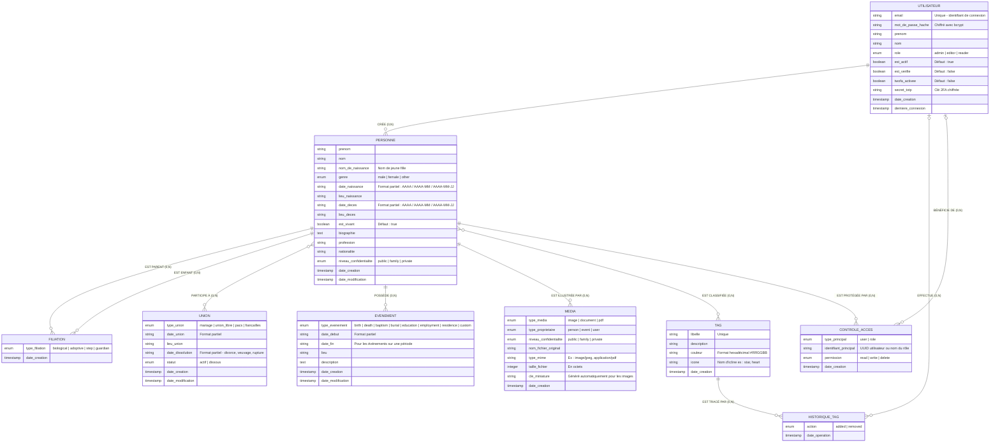

# Modèle Conceptuel de Données (MCD) — Genealogie App

**Méthode** : MERISE  
**Niveau** : Conceptuel  
**Version** : 2.0.0  
**Date** : Avril 2026

---

## Schéma MCD

---

## Tableau des cardinalités récapitulatif

| # | Association | Entité A | Card. A | Card. B | Entité B | Attributs portés |
| --- | --- | --- | :---: | :---: | --- | --- |
| 1 | **CRÉE** | UTILISATEUR | (0,N) | (0,1) | PERSONNE | — |
| 2 | **EST PARENT** | PERSONNE | (0,N) | (1,1) | FILIATION | — |
| 3 | **EST ENFANT** | PERSONNE | (0,N) | (1,1) | FILIATION | type_filiation |
| 4 | **PARTICIPE À** | PERSONNE | (0,N) | (0,N) | UNION | type_union, date_union, lieu_union, date_dissolution, statut |
| 5 | **POSSÈDE** | PERSONNE | (1,1) | (0,N) | ÉVÉNEMENT | type_evenement, date_debut, date_fin, lieu, description |
| 6 | **EST ILLUSTRÉE PAR** | PERSONNE | (1,1) | (0,N) | MÉDIA | type_media, nom_fichier, taille, type_mime |
| 7 | **EST CLASSIFIÉE** | PERSONNE | (0,N) | (0,N) | TAG | date_association |
| 8 | **EST PROTÉGÉE PAR** | PERSONNE | (1,1) | (0,N) | CONTRÔLE_ACCÈS | — |
| 9 | **BÉNÉFICIE DE** | UTILISATEUR | (0,1) | (0,N) | CONTRÔLE_ACCÈS | type_principal, permission |
| 10 | **EST TRACÉ PAR** | TAG | (1,1) | (0,N) | HISTORIQUE_TAG | action, date_operation |
| 11 | **EFFECTUE** | UTILISATEUR | (0,1) | (0,N) | HISTORIQUE_TAG | — |

---

## Description des associations

### 1. CRÉE

UTILISATEUR `(0,N)` — PERSONNE `(0,1)`

Un utilisateur peut créer de zéro à plusieurs fiches personnes.
Une personne est créée par zéro ou un utilisateur (null si importée via GEDCOM).

### 2 & 3. EST PARENT / EST ENFANT *(entité-association FILIATION)*

PERSONNE `(0,N)` — FILIATION `(1,1)`

Une personne peut être parent dans zéro à plusieurs filiations.
Une personne peut être enfant dans zéro à plusieurs filiations.
Chaque FILIATION relie exactement 1 parent à exactement 1 enfant.
Pour un enfant avec deux parents, on crée deux enregistrements FILIATION distincts.

| Valeur | Signification |
| --- | --- |
| `biological` | Enfant biologique |
| `adoptive` | Enfant adopté |
| `step` | Beau-fils / belle-fille |
| `guardian` | Enfant sous tutelle |

Contrainte : le système interdit toute FILIATION créant un cycle dans l'arbre.

### 4. PARTICIPE À *(association N-N avec attributs — UNION)*

PERSONNE `(0,N)` — UNION `(0,N)`

Une personne peut participer à zéro à plusieurs unions au cours de sa vie.
Une union implique exactement 2 personnes (contrainte métier).
L'association porte les informations de l'union : type, dates, lieu, statut.

| Valeur `type_union` | Signification |
| --- | --- |
| `mariage` | Union matrimoniale officielle |
| `union_libre` | Concubinage / union de fait |
| `pacs` | Pacte civil de solidarité |
| `fiancailles` | Fiançailles (lien précédant le mariage) |

| Valeur `statut` | Signification |
| --- | --- |
| `actif` | Union en cours |
| `dissous` | Séparés, divorcés ou veufs |

### 5. POSSÈDE

PERSONNE `(1,1)` — ÉVÉNEMENT `(0,N)`

Une personne peut avoir zéro à plusieurs événements biographiques.
Un événement appartient à exactement une personne.
Note : les événements `marriage` et `divorce` sont désormais portés par UNION.

| Valeur | Description | Date fin |
| --- | --- | :---: |
| `birth` | Naissance | Non |
| `death` | Décès | Non |
| `baptism` | Baptême | Non |
| `burial` | Enterrement | Non |
| `education` | Formation / Diplôme | Oui |
| `employment` | Emploi / Carrière | Oui |
| `residence` | Lieu de résidence | Oui |
| `custom` | Événement personnalisé | Oui |

### 6. EST ILLUSTRÉE PAR

PERSONNE `(1,1)` — MÉDIA `(0,N)`

Une personne peut être illustrée par zéro à plusieurs médias (photos, documents).
Un média est rattaché à exactement une entité (personne, événement ou utilisateur).
Les images génèrent automatiquement une miniature.

### 7. EST CLASSIFIÉE *(association N-N — TAG)*

PERSONNE `(0,N)` — TAG `(0,N)`

Une personne peut recevoir zéro à plusieurs tags.
Un tag peut être appliqué à zéro à plusieurs personnes.
L'association porte la date d'attribution du tag.

### 8. EST PROTÉGÉE PAR

PERSONNE `(1,1)` — CONTRÔLE_ACCÈS `(0,N)`

Une personne peut être protégée par zéro à plusieurs règles d'accès granulaires.
Chaque règle s'applique à exactement une personne.

### 9. BÉNÉFICIE DE

UTILISATEUR `(0,1)` — CONTRÔLE_ACCÈS `(0,N)`

Un utilisateur peut bénéficier de zéro à plusieurs droits d'accès.
Un contrôle d'accès peut être accordé à un utilisateur précis (`type_principal = user`)
ou à tous les membres d'un rôle (`type_principal = role`).
Dans ce dernier cas, la cardinalité côté UTILISATEUR est `(0,1)`.

### 10. EST TRACÉ PAR

TAG `(1,1)` — HISTORIQUE_TAG `(0,N)`

Chaque modification de tag génère une entrée dans l'historique.
L'historique est en lecture seule — non modifiable, non supprimable.

### 11. EFFECTUE

UTILISATEUR `(0,1)` — HISTORIQUE_TAG `(0,N)`

Une entrée d'historique est réalisée par zéro ou un utilisateur (null si action système).

---

## Changements par rapport à la version 1.0

| Élément supprimé | Raison | Remplacement |
| --- | --- | --- |
| `ROLE_DANS_UNION` | Sur-modélisation inutile | Association directe PERSONNE ↔ UNION |
| `CEREMONIE` | Cas d'usage non justifié | Champs `date_union` et `lieu_union` sur UNION |
| `CONTRAT` | Cas d'usage non justifié | Fichier MÉDIA de type `document` |
| Événements `marriage` / `divorce` | Redondants avec UNION | Portés par l'entité UNION |

---

## Contraintes et règles métier

| # | Règle |
| --- | --- |
| R1 | Un utilisateur nouvellement inscrit obtient le rôle `reader` par défaut |
| R2 | Les dates acceptent trois précisions : `AAAA`, `AAAA-MM`, `AAAA-MM-JJ` |
| R3 | Une FILIATION ne peut pas créer un cycle dans l'arbre généalogique |
| R4 | Chaque UNION implique exactement 2 personnes |
| R5 | Une personne `private` n'est visible que par son créateur ou via ACL explicite |
| R6 | La permission ACL `delete` implique `write` et `read` |
| R7 | L'HISTORIQUE_TAG est en lecture seule |
| R8 | Le libellé d'un TAG est unique dans l'application |
| R9 | La suppression d'une personne entraîne la suppression en cascade de ses filiations, unions, événements, médias et tags |
| R10 | Un média de type `image` génère automatiquement une miniature |

---

MCD — Genealogie App v2.0.0 — Méthode MERISE — Avril 2026
