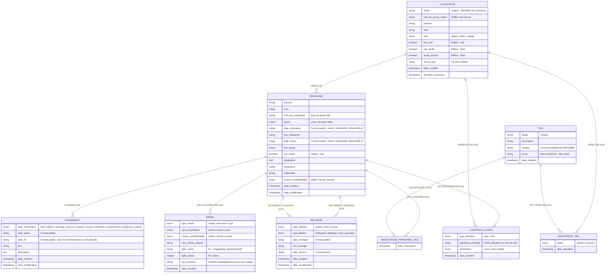

# Modèle Conceptuel de Données (MCD) — Genealogie App

**Méthode** : MERISE  
**Niveau** : Conceptuel  
**Version** : 1.0.0  
**Date** : Avril 2026

---

## Schéma MCD

---

## Description des associations

### CRÉE
**UTILISATEUR** `(0,N)` — **PERSONNE** `(0,1)`

> Un utilisateur peut créer de zéro à plusieurs fiches de personnes.  
> Une personne est créée par zéro ou un utilisateur (null si importée).

---

### POSSÈDE
**PERSONNE** `(1,1)` — **ÉVÉNEMENT** `(0,N)`

> Une personne peut avoir zéro à plusieurs événements dans sa timeline.  
> Un événement appartient à exactement une personne.

---

### EST ILLUSTRÉE PAR
**PERSONNE** `(1,1)` — **MÉDIA** `(0,N)`

> Une personne peut être illustrée par zéro à plusieurs médias (photos, documents).  
> Un média est rattaché à exactement une entité (personne, événement ou utilisateur).

---

### EST LIÉE À *(association réflexive — entité-association RELATION)*
**PERSONNE** `(0,N)` — **RELATION** — **PERSONNE** `(0,N)`

> Une personne peut être impliquée dans zéro à plusieurs relations familiales.  
> Chaque relation relie exactement deux personnes.  
> **Deux types :**
> - `parent_child` : la première personne est le **parent**, la seconde est l'**enfant**
> - `couple` : les deux personnes sont des **conjoints** (ordre indifférent)
>
> **Contrainte métier :** le système interdit toute relation créant un **cycle** dans l'arbre.

---

### EST CLASSIFIÉE *(entité-association ASSOCIATION_PERSONNE_TAG)*
**PERSONNE** `(0,N)` — **ASSOCIATION_PERSONNE_TAG** — **TAG** `(0,N)`

> Une personne peut recevoir zéro à plusieurs tags.  
> Un tag peut être appliqué à zéro à plusieurs personnes.  
> L'association porte la date d'attribution du tag.

---

### EST PROTÉGÉE PAR
**PERSONNE** `(1,1)` — **CONTRÔLE_ACCÈS** `(0,N)`

> Une personne peut être protégée par zéro à plusieurs règles d'accès.  
> Un contrôle d'accès porte sur exactement une personne.

---

### BÉNÉFICIE DE
**UTILISATEUR** `(1,1)` — **CONTRÔLE_ACCÈS** `(0,N)`

> Un utilisateur peut bénéficier de zéro à plusieurs droits d'accès sur des fiches.  
> Un contrôle d'accès est accordé à exactement un utilisateur (ou un rôle).

---

### EST TRACÉ PAR
**TAG** `(1,1)` — **HISTORIQUE_TAG** `(0,N)`

> Un tag peut générer zéro à plusieurs entrées dans l'historique.  
> Une entrée d'historique concerne exactement un tag.

---

### EFFECTUE
**UTILISATEUR** `(0,1)` — **HISTORIQUE_TAG** `(0,N)`

> Un utilisateur peut avoir effectué zéro à plusieurs opérations sur des tags.  
> Une opération d'historique est réalisée par zéro ou un utilisateur (null si système).

---

## Tableau des cardinalités récapitulatif

| Association | Entité A | Card. A | Card. B | Entité B |
|---|---|:---:|:---:|---|
| CRÉE | UTILISATEUR | (0,N) | (0,1) | PERSONNE |
| POSSÈDE | PERSONNE | (1,1) | (0,N) | ÉVÉNEMENT |
| EST ILLUSTRÉE PAR | PERSONNE | (1,1) | (0,N) | MÉDIA |
| EST LIÉE À *(réflexive)* | PERSONNE | (0,N) | (0,N) | PERSONNE |
| EST CLASSIFIÉE | PERSONNE | (0,N) | (0,N) | TAG |
| EST PROTÉGÉE PAR | PERSONNE | (1,1) | (0,N) | CONTRÔLE_ACCÈS |
| BÉNÉFICIE DE | UTILISATEUR | (1,1) | (0,N) | CONTRÔLE_ACCÈS |
| EST TRACÉ PAR | TAG | (1,1) | (0,N) | HISTORIQUE_TAG |
| EFFECTUE | UTILISATEUR | (0,1) | (0,N) | HISTORIQUE_TAG |

---

## Contraintes et règles métier

| # | Règle |
|---|---|
| R1 | Un utilisateur nouvellement inscrit obtient le rôle `reader` par défaut |
| R2 | Les dates acceptent trois niveaux de précision : `AAAA`, `AAAA-MM`, `AAAA-MM-JJ` |
| R3 | Une relation `parent_child` ne peut pas créer un cycle dans l'arbre généalogique |
| R4 | Un médias de type `image` génère automatiquement une miniature |
| R5 | Une personne `private` n'est visible que par son créateur ou les utilisateurs avec ACL |
| R6 | La permission ACL `delete` implique `write` et `read` |
| R7 | L'historique des tags est en lecture seule (non modifiable) |
| R8 | Le libellé d'un tag est unique dans l'application |
| R9 | La suppression d'une personne entraîne la suppression de ses événements, médias et tags associés |

---

*MCD — Genealogie App v1.0.0 — Méthode MERISE — Avril 2026*
